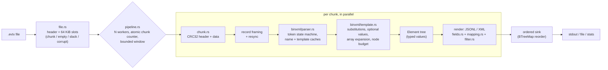

# evtxkit

A Windows XML Event Log (**EVTX**) parser written from scratch in Rust — file
header, 64 KiB chunks, record framing, the BinXML token stream, templates and
substitutions, CRC32 verification — with a chunk-parallel JSONL pipeline and a
Sigma-style field-mapping layer for detection work.

```console
$ evtxkit dump Security.evtx > security.jsonl                    # every record as one JSON object
$ evtxkit grep --category process_creation -w 'Image|endswith=\powershell.exe' Sysmon.evtx
$ evtxkit stats --chunks damaged.evtx                            # chunk health, CRC status, recovered records
```

**Who it is for:** detection engineers and incident responders who need to
turn `.evtx` files from a lab or a triage collection into something
greppable, and who care about what happens when the file is damaged. It is
also a readable reference implementation of the format: `docs/FORMAT.md`
documents every structure the code decodes.

**Why another parser:** existing parsers are mature (see *Prior art* below).
This one exists to show the format end to end in ~3,800 lines of
dependency-light code, with the properties a detection pipeline needs made
explicit and tested: byte-exact agreement with a reference parser, no panics
on hostile input, ordered parallel output, honest reporting of corruption,
and field names that line up with Sigma rules.

## Results at a glance

| claim | evidence | command |
|-------|----------|---------|
| Matches the reference parser (`evtx` 0.12.3) on **all 4,805 records** of 9 public sample logs | `tests/golden.rs` | `cargo test --test golden` |
| Never panics on corrupted input (mutated real logs, random token streams, random bytes, exhaustive byte flips) | `tests/corruption.rs` | `cargo test --test corruption` |
| Parallel output is byte-identical to sequential output for 1–16 threads | `tests/pipeline.rs`, demo step 10 | `cargo test --test pipeline` |
| 97 tests (incl. 1 doctest); **97.7 %** line coverage (all tests), **~90 %** of shipped code from integration tests alone | `make check`, `make coverage-shipped` | see *Testing* |
| One-thread decode **250 MiB/s**, 8 threads **790 MiB/s** (parse); JSONL dump 143 → 664 MiB/s | `bench/RESULTS.md` | `./scripts/bench.sh` |

## Architecture



Chunks are self-contained (each holds the names and templates its records
use), so a chunk is the unit of parallelism. Workers decode **and render** a
whole chunk; the main thread re-orders results so output never depends on the
thread count, and a window caps how far workers may run ahead, which bounds
memory independently of file size. Details and complexity analysis:
[`docs/ARCHITECTURE.md`](docs/ARCHITECTURE.md). Byte layouts:
[`docs/FORMAT.md`](docs/FORMAT.md).

## Quickstart

Requires Rust 1.85+ (edition 2024).

```console
$ cargo build --release
$ ./target/release/evtxkit stats tests/data/security.evtx
$ ./target/release/evtxkit dump -f xml tests/data/new-user-security.evtx | head
$ make check      # format, clippy, rustdoc, tests, coverage >= 80 %
$ make demo       # offline end-to-end demo on the bundled samples
```

### Commands

| command | does |
|---------|------|
| `evtxkit dump [-f jsonl\|xml\|fields] [-w EXPR]... [--sigma\|--mapping FILE] [--emit-errors] [-o FILE] FILES...` | decode records |
| `evtxkit grep [-e TEXT] [-w EXPR]... [--category C] [--service S] [-c] FILES...` | print (or count) matching records; exit 1 if none |
| `evtxkit stats [--json] [--chunks] [--by FIELD] [--top N] FILES...` | file health and top-N summaries |

Common options: `-t/--threads N`, `--strict-crc` (skip chunks whose CRC32
fails instead of reporting and decoding them), `-v`/`-q`.

### Field filters

`-w` takes Sigma-flavoured expressions over the flat field view (all `-w` are
ANDed):

```text
EventID=4624                          exact, case-insensitive
Image|endswith=\cmd.exe               contains / startswith / endswith / re
CommandLine=*-enc*                    * and ? wildcards (backslash is literal unless before * ? \)
LogonType|in=2,10,11                  any of a list
EventID>=4700                         numeric (decimal or 0x hex)
TargetUserName|exists=true            presence
CommandLine|re|cased=^PowerShell      regex, case-sensitive
```

With `--sigma` (or `--category`/`--service`, which imply it) fields are renamed
to the Sigma taxonomy by [`mappings/sigma-windows.yml`](mappings/sigma-windows.yml)
and tagged with a logsource, so one expression like `Image|endswith=\cmd.exe`
works for both Sysmon event 1 and Security event 4688 (`NewProcessName → Image`).
`--mapping my.yml` loads a custom mapping with the same schema.

## Demo

Excerpts from `make demo` (`scripts/demo.sh`, bundled samples only, no network).
The script runs ten steps; run it to see the full output, including a record
as JSONL, the same record as XML and a flat Sigma field object.

```text
==> 1. File health: chunks, CRC32 verification, record counts
$ evtxkit stats tests/data/security.evtx
tests/data/security.evtx
  format     3.1, header CRC ok, dirty
  slots      33 (26 chunks, 7 empty, 0 slack, 0 corrupt, 0 skipped)
  crc32      header mismatches 0, record-data mismatches 0, disabled 0
  records    2261 decoded, 0 errors, 0 recovered, 0 size-copy mismatches
  templates  240
  ids        1 .. 2261
  time       2016-07-08T18:12:51.681640Z .. 2017-04-14T01:21:10.906949Z
  event ids  4907 (620), 4624 (583), 4672 (459), 5058 (102), 5061 (102)
  providers  Microsoft-Windows-Security-Auditing (2224), Microsoft-Windows-Eventlog (37)
  channels   Security (2261)
  computers  WIN-03DLIIOFRRA (2219), 37L4247F27-25 (42)

==> 4. Sigma-style hunting: process creations spawned by cmd.exe
$ evtxkit grep --category process_creation -w 'ParentImage|endswith=\cmd.exe' -c tests/data/sysmon.evtx
136

==> 5. ...stacked by Image (top 5), using the Sigma field mapping
$ evtxkit stats --sigma --by Image --top 5 tests/data/sysmon.evtx | tail -n 1
  by Image   C:\Windows\SysWOW64\PING.EXE (131), (missing) (61), C:\Program Files\Opera\49.0.2725.64\installer.exe (11), C:\Windows\System32\UI0Detect.exe (10), C:\Windows\system32\svchost.exe (10)

==> 7. Logon events by logon type
$ evtxkit grep -c -w EventID=4624 -w 'LogonType|in=2,10,11' tests/data/security.evtx  (interactive/remote/cached)
84

==> 8. A damaged log: corrupt slots, stale record CRCs, records recovered by resync
$ evtxkit stats --chunks tests/data/sample_with_a_bad_chunk_magic.evtx
 WARN chunk 6 @ 0x61000: bad chunk signature at offset 0x61000 file=tests/data/sample_with_a_bad_chunk_magic.evtx
 WARN chunk 7 @ 0x73060: bad record signature at offset 0x2060 file=tests/data/sample_with_a_bad_chunk_magic.evtx
 WARN chunk 10 @ 0xa1000: bad chunk signature at offset 0xa1000 file=tests/data/sample_with_a_bad_chunk_magic.evtx
tests/data/sample_with_a_bad_chunk_magic.evtx
  format     3.1, header CRC ok, dirty
  slots      16 (4 chunks, 10 empty, 0 slack, 2 corrupt, 0 skipped)
  crc32      header mismatches 0, record-data mismatches 3, disabled 0
  records    301 decoded, 1 errors, 31 recovered, 3 size-copy mismatches
  templates  8
  ids        45691 .. 47705
  time       2018-08-07T15:51:15.724872Z .. 2018-08-08T16:40:15.820702Z
  event ids  325 (300), 0 (1)
  providers  Microsoft-Windows-AppXDeployment (300), (empty) (1)
  channels   Microsoft-Windows-AppXDeployment/Operational (300), (empty) (1)
  computers  DESKTOP-1N4R894 (301)
  slot  kind     record ids              hdr-crc   data-crc  templates
     0  chunk    46728..46857            ok        MISMATCH  2
     1  empty    -                       -         -         0
     2  empty    -                       -         -         0
     3  empty    -                       -         -         0
     4  empty    -                       -         -         0
     5  empty    -                       -         -         0
     6  corrupt  -                       -         -         0
     7  chunk    47628..47705            ok        MISMATCH  2
     8  chunk    45691..45819            ok        ok        2
     9  chunk    45820..45949            ok        MISMATCH  2
    10  corrupt  -                       -         -         0
    11  empty    -                       -         -         0
    12  empty    -                       -         -         0
    13  empty    -                       -         -         0
    14  empty    -                       -         -         0
    15  empty    -                       -         -         0

==> 9. Strict CRC policy drops chunks whose checksums fail
$ evtxkit grep -c -q --strict-crc -e AppXDeployment tests/data/sample_with_a_bad_chunk_magic.evtx
129

==> 10. Chunk-parallel output is byte-identical to single-threaded output
$ evtxkit dump -t 1 tests/data/system.evtx | sha256 ; evtxkit dump -t 8 tests/data/system.evtx | sha256
t=1  42d6e0ec504c8a5b
t=8  42d6e0ec504c8a5b
```

## Evaluation: agreement with a reference parser

`scripts/gen-golden.sh` builds `tools/refdump` against the reference parser
(`evtx` 0.12.3 from crates.io, a widely used Rust EVTX parser) and
records every record of every sample as a canonical tree (element names,
attribute order and values, text). `tests/golden.rs` decodes the same files
with evtxkit and requires the trees, record ids and timestamps to be equal.

| sample | records compared | result |
|--------|-----------------:|--------|
| security.evtx | 2,261 | identical |
| system.evtx | 1,881 | identical |
| sysmon.evtx | 358 | identical |
| sample_with_a_bad_chunk_magic.evtx | 270 | identical (+31 records only evtxkit recovers, see below) |
| Application_no_crc32.evtx | 17 | identical |
| Security_short_selected.evtx | 7 | identical |
| HelloForBusiness-Operational.evtx | 6 | identical |
| new-user-security.evtx | 4 | identical |
| MSExchange_Management_wec.evtx | 1 | identical |
| **total** | **4,805** | **identical** |

In the damaged sample one chunk has a broken record header mid-chunk. The
reference parser abandons the rest of that chunk; evtxkit resynchronises on the
next well-framed record and decodes 31 more records, marked `recovered`. They
cannot be checked against the oracle and are excluded from the comparison
(the test asserts recovery happens in that file only).

The comparison is semantic, not textual: both tools pretty-print XML
differently, and indentation says nothing about parse correctness.

## Benchmarks

`./scripts/bench.sh` (wraps `cargo bench --bench throughput`) builds a 59 MiB
input by stitching every valid chunk of the committed samples 16 times — real
events, repeated — and measures two workloads: `parse` (decode every record
into its tree) and `dump` (decode + render JSONL, output discarded).

- Date: 2026-10-26
- Machine: Apple M5 Pro (Darwin arm64), 15 logical cores
- Input: synthetic file stitched from the committed samples' chunks (see DATA.md)

input: 944 chunks, 59.0 MiB (16 copies of 59 sample chunks); median of 7 runs

| workload | threads | median s | MiB/s | records/s | speedup |
|----------|--------:|---------:|------:|----------:|--------:|
| parse | 1 | 0.236 | 249.9 | 327737 | 1.00x |
| parse | 2 | 0.159 | 370.2 | 485421 | 1.48x |
| parse | 4 | 0.096 | 614.4 | 805659 | 2.46x |
| parse | 8 | 0.075 | 789.6 | 1035485 | 3.16x |
| dump | 1 | 0.412 | 143.4 | 188026 | 1.00x |
| dump | 2 | 0.243 | 242.7 | 318211 | 1.69x |
| dump | 4 | 0.135 | 436.3 | 572108 | 3.04x |
| dump | 8 | 0.089 | 663.5 | 870082 | 4.63x |

Numbers depend on the machine; `bench/RESULTS.md` is overwritten by each run
of the script. The input repeats the same chunks, so it exercises the decoder
and renderer, not cache misses on a large, varied log.

### Memory under hostile input

`make hostile-rss` builds hostile files by hand (shapes in
`tests/common/hostile.rs`) and reports `evtxkit dump` peak RSS. Except for the
last four rows, each file is a single 69,632-byte file (one 64 KiB chunk). The
"stalled" runs pipe stdout into a consumer that sleeps first, so the pipeline
window fills. Peak RSS varies by tens of MB between runs.

```text
file                     bytes threads stalled peak_rss_MB record_errors
A-array-500              69632       1      no           8             1
B-instances-400          69632       1      no           9             1
C-records-300            69632       1      no          69           290
D-string-25000           69632       1      no           9             1
C-records-300-x64      4198400       1     yes         270         18560
C-records-300-x64      4198400       8     yes         698         18560
C-records-300-x1024   67112960       1     yes         307        296960
C-records-300-x1024   67112960       8     yes         682        296960
```

Budget design and the threat each file models are in
[`docs/THREAT_MODEL.md`](docs/THREAT_MODEL.md) (T4, T11).

## Testing

```console
$ make check             # data checksums, fmt, clippy -D warnings (all targets), rustdoc -D warnings,
                         # then all tests under cargo-llvm-cov with --fail-under-lines 80
$ make coverage-shipped  # integration tests only: coverage of shipped code, unit-test code not compiled
$ make hostile-rss       # peak memory on hand-built hostile files (needs /usr/bin/time; not part of check)
$ ./scripts/loc.sh       # line counts (shipped source vs tests)
```

CI (`.github/workflows/ci.yml`) runs `make check` on Ubuntu and macOS, then
`make demo` and a short benchmark smoke run.

| suite | what it proves |
|-------|----------------|
| unit tests (48, in `src/`) | primitives: cursor bounds, CRC vectors, calendar math, value rendering, filters, mapping, stats, node-budget accounting |
| `tests/golden.rs` (11) | byte-level agreement with the reference parser on 4,805 records |
| `tests/synthetic.rs` (13) | hand-assembled chunks for every token type, nested BinXML, arrays, limits, hostile expansions, resync, CRC policies |
| `tests/budget.rs` (1 test, plus 2 `#[ignore]`d measurement tools) | samples fit budgets 100x/20x below the defaults; writes the hostile files for `make hostile-rss` |
| `tests/corruption.rs` (8) | proptest: mutated real logs, random token streams, random bytes never panic; CRC32 = `crc32fast`; glob = regex |
| `tests/pipeline.rs` (3) | parallel = sequential output; sink errors stop workers |
| `tests/cli.rs` (12) | every subcommand end to end, exit codes, closed pipes, logging, a hostile node-budget file |

Line coverage from `make check` in a fresh clone:
**97.7 %** of 3,776 lines (this includes unit-test code that lives in `src/`);
`make coverage-shipped`: **90.1 %** of 2,844 shipped lines (it varies by a few
tenths across runs, because proptest draws new random inputs each run).
`scripts/loc.sh`: 5,035 lines of non-test source (3,894 code lines), 3,349
lines of tests and benchmark code (1,196 of them unit tests inside `src/`).

## Design decisions

The full list with trade-offs is in [`DECISIONS.md`](DECISIONS.md). The ones
that shape behaviour:

* **Report, don't hide, damage.** CRC mismatches are reported but chunks are
  still decoded by default, because Windows leaves record CRCs stale in dirty
  logs (3 of 4 chunks in the damaged sample). `--strict-crc` opts into
  skipping. Corrupt slots, size-copy mismatches and recovered records are
  counted in `stats`.
* **Don't trust the header's chunk count.** `sysmon.evtx` declares one chunk
  and holds nine; every 64 KiB slot is examined and classified.
* **Bounded everything.** Explicit element stack, fragment depth ≤ 8, element
  depth ≤ 64, O(chunk) resync, bounded pipeline window, and a node budget that
  charges every created or cloned node its full deep size: ≤ 100 000 units
  per record and ≤ 1 000 000 per chunk (a unit is a node or 64 payload bytes).
  Array copies are charged their full deep size before they are cloned. See
  *Memory under hostile input* and
  [`docs/THREAT_MODEL.md`](docs/THREAT_MODEL.md).
* **Typed tree, two output shapes.** The tree keeps value types, so JSONL has
  native numbers (`"EventID":4624`) while the flat `fields` view is all text
  with Sigma names for rule matching.
* **From scratch where it matters.** CRC32, calendar conversion, BinXML,
  templates and the JSON writer are hand-written; `clap`, `serde`, `regex`,
  `tracing` and `thiserror` are used for the CLI and configuration layers.

## Limitations

* **Not a tamper detector.** CRC32 catches accidental corruption only; anyone
  who edits a log can recompute it.
* Golden agreement is proven on 9 public samples (4,805 records). Logs from
  other Windows versions or providers may contain constructs the samples
  never exercise; those paths are covered only by synthetic tests.
* No message rendering: evtxkit outputs the stored event data, not the
  localised message text, which would need the provider's resource DLLs.
* ANSI strings are always decoded as Windows-1252.
* `EvtHandle` and `EvtXml` substitution values are rejected (the reference
  parser rejects them too); they are not expected in stored logs.
* Whole files are read into memory (no mmap); multi-GB carved images would
  need that much RAM.
* The node budgets bound memory, not to a small figure: a hostile file whose
  every chunk exhausts its budget peaks at about 700 MB with 8 threads and a
  stalled consumer (`make hostile-rss`). The limits are not configurable
  from the CLI; a genuine log that exceeds them loses those records (the
  samples use at most 255 units per record and 12,849 per chunk).
* Records recovered by resynchronisation have no oracle to compare against.
* XML output escapes control characters as `&#xNN;`, which strict XML 1.0
  parsers reject (one record in the samples contains such a character).
* The Sigma layer maps fields and logsources; it does not compile or run Sigma
  rules. Only a subset of Sigma categories is mapped (Sysmon 1–26, Security
  4688/4689/5156, PowerShell 4103/4104).
* Fuzzing is proptest-based (256 cases per property per run plus an
  exhaustive byte-flip sweep), not coverage-guided fuzzing over CPU-days.
* Benchmark figures come from one machine; re-run `./scripts/bench.sh` for
  your own.

## Roadmap

1. Coverage-guided fuzzing (`cargo fuzz`) of `ChunkContext::parse_record`.
2. Memory-mapped input and streaming for very large or carved files.
3. Carving mode: scan arbitrary images (unallocated space, memory dumps) for
   `ElfChnk` and record signatures.
4. Evaluate Sigma rules directly (detection-as-code) on top of the field layer.
5. Golden tests against a second reference implementation (libevtx) and more
   providers (WEC-forwarded `RenderingInfo`, PowerShell 4104 script blocks).
6. Optional zero-copy tree (borrowed strings) to cut allocations further.

## Prior art

* [`evtx`](https://github.com/omerbenamram/EVTX) (Rust) — the reference parser
  used here for golden files; more mature and more complete (WEVT
  template-cache fallback, more output modes).
* [libevtx](https://github.com/libyal/libevtx) (C) — format documentation
  this work relied on alongside MS-EVEN6.
* [python-evtx](https://github.com/williballenthin/python-evtx) (Python).
* Chainsaw and Hayabusa — Sigma-based hunting tools built on EVTX parsers.

## Data and license

Sample logs: public test fixtures from the `omerbenamram/EVTX` repository
(MIT/Apache-2.0), pinned by commit and SHA-256 — see [`DATA.md`](DATA.md).
Code: MIT, see [`LICENSE`](LICENSE).
