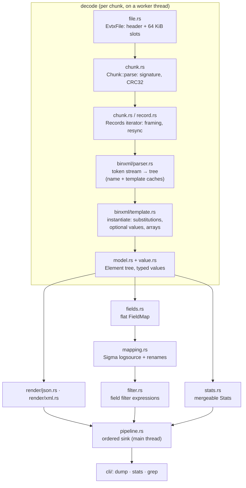

# Architecture

evtxkit is one library crate (`src/lib.rs`) and a thin binary (`src/main.rs`,
`src/cli/`). The library has no `unsafe` (`#![forbid(unsafe_code)]` via
`[lints]`), no global state and no I/O beyond `EvtxFile::open`.



## Module map

| module | responsibility | key types |
|--------|----------------|-----------|
| `bytes` | bounds-checked little-endian reads, UTF-16 decoding | `Cursor` |
| `crc32` | slicing-by-8 CRC-32 | `Crc32`, `crc32()` |
| `time` | FILETIME/SYSTEMTIME → ISO-8601 (no date library) | `FileTime`, `SystemTime` |
| `error` | one error enum, every variant carries an offset | `EvtxError` |
| `file` | file header, slot classification | `EvtxFile`, `FileHeader` |
| `chunk` | chunk header, checksums, record iteration, table walking | `Chunk`, `ChunkSlot`, `Records`, `CrcStatus` |
| `record` | record framing | `RecordHeader`, `Record`, `RecordError` |
| `binxml::parser` | token state machine, names, template cache, limits | `ChunkContext`, `Limits` |
| `binxml::template` | template definitions and instantiation | `TemplateDef`, `TemplateValue` |
| `value` / `model` | typed values and the element tree | `Value`, `Element`, `Node` |
| `render` | JSONL and XML writers | `json::write_record`, `xml::record_document` |
| `fields` | flat view for detection logic | `FieldMap`, `flatten()` |
| `mapping` | YAML field mapping → Sigma logsource | `Mapping`, `LogSource` |
| `filter` | `Field|mod=value` expressions | `Filter`, `FilterSet` |
| `stats` | per-chunk statistics, merged in order | `Stats`, `Counter` |
| `pipeline` | parallel, ordered, bounded execution | `run()`, `decode_slot()` |
| `synth` | build multi-chunk files from real chunks | `stitch()` |

## Key algorithms

### Slicing-by-8 CRC32 — O(n) time, O(1) space

Eight 256-entry tables are generated by a `const fn` at compile time. Each
loop iteration XORs 8 input bytes into the CRC and resolves them with 8
independent lookups, which the CPU can overlap, instead of 8 dependent
byte-at-a-time steps. Verified against `crc32fast` by a property test.

### BinXML parsing — O(tokens) time, O(depth) auxiliary space

`ChunkContext::parse_fragment` is a single loop over tokens with an explicit
stack of open elements, so arbitrarily nested XML cannot overflow the Rust
stack. Recursion only occurs for nested fragments (template definitions and
BinXML-typed values) and is capped by `Limits::max_fragment_depth` (8); element
depth per fragment is capped at 64. Every read goes through `Cursor`, which
returns `EvtxError::Truncated` instead of indexing out of bounds.

Names and template definitions are cached per chunk in `HashMap`s keyed by
chunk offset, so each is decoded once per chunk (O(1) expected lookup). A
template definition that fails to parse is cached as an error.

### Template instantiation — O(nodes created), bounded

Instantiation deep-copies the definition tree, substituting values. Each
definition pre-computes how many times every substitution index occurs, so a
value is **moved** into the tree on its last use and cloned only when a
template uses it twice. (One-thread `parse` throughput went from 134.6 to
173.4 MiB/s with this change — commit `1748f9a`, `cargo bench --bench
throughput -- --copies 4 --runs 3 --threads 1`, single runs on a loaded
machine, so treat the ratio as indicative.) Array values repeat
their containing element; because several arrays multiply, every created node
is charged against a budget (`Limits::max_nodes`, default 100 000) and
exceeding it is an error, not an allocation storm.

### Record resynchronisation — O(chunk) per chunk

After a framing error the iterator scans forward for the next offset whose
signature, size and trailing size copy agree. The scan never revisits bytes,
so a chunk costs O(65 536) in the worst case regardless of how many errors it
contains.

### Chunk-parallel pipeline — O(window) memory

```
next: AtomicUsize ──► worker 0 ─┐
                  ──► worker 1 ─┼─ sync_channel(window) ─► BTreeMap reorder ─► sink
                  ──► worker N ─┘
```

Workers claim chunk indexes from an atomic counter, decode and render the
whole chunk (rendering is most of the cost, so it must happen in parallel),
and send `(index, result)` to the main thread. The sink re-orders through a
`BTreeMap` and consumes strictly in index order, so output is byte-identical
for any thread count (tested for 1–16 threads and windows 1–64).

Backpressure: a worker holding index `i` waits on a condition variable until
`i < emitted + window`. At most `window + threads` chunk results exist at once,
so memory is O(window · chunk output) — independent of file size. The lowest
outstanding index is always admitted, so the scheme cannot deadlock. A sink
error (for example a closed pipe) sets an abort flag, wakes all workers and
drops the receiver, so `run` returns promptly.

### JSON rendering — O(nodes)

Each element is written directly into the output buffer. The JSON key of a
child is its name, or its `Name` attribute for `<Data Name=…>`. If all keys of
an element are unique (the common case; checked pairwise for ≤ 16 children,
with a `HashSet` above that) children are written in place; otherwise they
are grouped into arrays in first-appearance order. Writing in place instead of
building per-child strings raised one-thread `dump` throughput from 58.3 to
82.1 MiB/s (commit `dcb215d`, same command and caveat as above).

### Filters — O(n) / O(n·m)

`contains`/`startswith`/`endswith` are O(n) after case folding. Wildcard
values use the two-pointer greedy-star algorithm, O(n·m) worst case and O(n)
typically; a property test checks it against an equivalent regex. `|re` uses
the `regex` crate (linear-time matching, compiled size capped at 1 MiB).

## Error handling

* The library never panics on input. `EvtxError` is `Clone + PartialEq` and
  carries the offset of every failure.
* Failures are scoped as narrowly as possible: a bad value fails one record, a
  bad record framing triggers resync within the chunk, a bad chunk affects
  only its slot, and only an unreadable or non-EVTX file header fails the file.
* The CLI logs record errors as warnings (stderr), exits 2 on usage/IO errors
  and 1 when `grep` matches nothing; a closed stdout pipe ends output quietly.

## Testing strategy

| layer | tests |
|-------|-------|
| primitives | unit tests in each module (cursor bounds, CRC vectors, calendar math, value rendering) |
| correctness | `tests/golden.rs`: 4,805 records of 9 public samples must equal the reference parser's trees |
| token coverage | `tests/synthetic.rs`: hand-built chunks for CDATA, char/entity refs, PIs, nested BinXML, arrays, limits, resync, CRC policy |
| robustness | `tests/corruption.rs`: proptest mutation of real files, random token streams, random bytes, exhaustive byte flips |
| concurrency | `tests/pipeline.rs`: parallel output equals sequential output; sink errors stop workers |
| CLI | `tests/cli.rs`: every subcommand, exit codes, broken pipe, logging |

## Memory model and limits

`EvtxFile` reads the whole file into memory (`std::fs::read`). Windows caps
each log at a configured maximum size (20 MiB by default for the classic
Application, Security and System logs), so this keeps the code simple;
memory-mapping is on the roadmap. Each decoded chunk produces an owned tree per record; the
pipeline window bounds how many chunks are alive.
